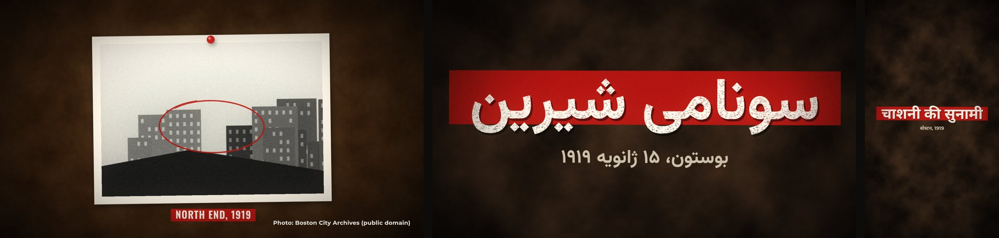
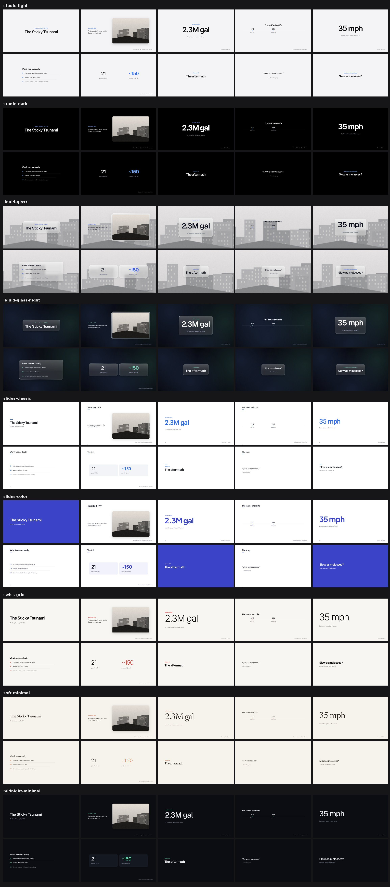
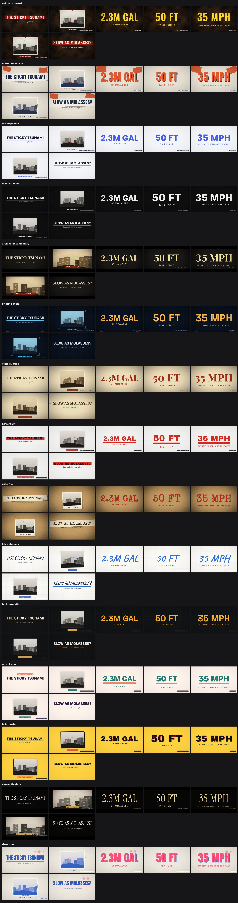

<h1 align="center">docuframe</h1>

<p align="center"><b>Give it a topic or a script, get a finished documentary or explainer film in the style you pick.</b></p>

<p align="center">
  
  
  
</p>

<p align="center"></p>
<p align="center"><sub>English 16:9 · Persian right-to-left · Hindi 9:16 — same project format, same engine. (Hero video lands with the first release.)</sub></p>

## Install

```
npx skills add moiensaboohi/docuframe
```

Then ask your agent: *"Make a 3 minute documentary about the Great Molasses Flood."*

<details><summary>Claude Code plugin marketplace</summary>

```
/plugin marketplace add moiensaboohi/docuframe
/plugin install docuframe@docuframe
```
</details>

<details><summary>Codex, Cursor, Gemini CLI, OpenCode</summary>

The repo ships `.codex-plugin/`, `.cursor-plugin/`, `gemini-extension.json` and `AGENTS.md`.
Or copy `skills/docuframe` into your agent's skills folder. The engine is a Python package:
`pip install "git+https://github.com/moiensaboohi/docuframe"` (the skill tells you if it is missing).
</details>

<details><summary>Claude app (no terminal)</summary>

Download `docuframe-skill-<version>.zip` from Releases and upload it as a skill. The engine is bundled
inside. Where the app can run code, it renders there; otherwise use the cloud option below.
</details>

<details><summary>One click in the browser (no installs)</summary>

Click **Code → Codespaces → Create codespace**. Python, ffmpeg, the engine and the local voice are
preinstalled; open `docs/START-HERE.md`.
</details>

First run on your machine: `docuframe doctor` checks everything and prints the exact fix for
Windows, macOS or Linux.

## Ask it like this

> "Make a 2 minute documentary about the Great Molasses Flood of 1919."

> "Turn this script into a YouTube explainer with sources and chapters. Let me approve the stills first."

> "Here's my script and my recording, make the video in 16:9 and a 9:16 short."

> "یک مستند کوتاه درباره‌ی کانال سوئز بساز."

> "Dub last week's episode into Spanish."

## What you get

- the film (16:9 up to 30 min; 9:16 and 1:1 cut from the same project)
- SRT and VTT captions that match the narration word for word
- a YouTube package: 3 titles, a description with chapters, sources and image credits, tags, 3 thumbnails, an upload checklist
- `manifest.json`: every source, image licence, font and voice, and the one command that re-renders it

## How it works

1. **Research** — the agent writes a fact sheet: every claim with its sources. No source, no claim.
2. **Script** — hook in the first 10 seconds, chapters, numbers written the way they're spoken.
3. **Voice** — a free local voice, your own recording, or any TTS you have a key for.
4. **Beats** — `film.json`: each beat a scene (photo, map, quote, big number, timeline…) that lands on a spoken word.
5. **Approval stills** — one frame per beat; the agent reviews them, you can too.
6. **Render** — drawn by code (Skia), in resumable chunks with an ETA; runs on a 16 GB laptop.
7. **Check and package** — legibility, safe areas, sources, licences, captions, chapters; then the YouTube package.

## Styles

Twenty-four built-in looks, all drawn by code, in two families. Same film, same facts — pick the look.

### Modern minimal

<p align="center"></p>

Small confident type on a real grid, soft blur-in motion, numbers that count up with a thin meter, real frosted glass over the film's own photographs.

| Style | Look | Best for |
|---|---|---|
| `studio-light` | Product-keynote calm: soft light-grey stage, centred tight headlines in a modern sans, lots of air, photos with rounded corners, every element rising in with a soft blur. | technology and products, business and strategy, clean explainers of any kind |
| `studio-dark` | A black keynote stage: centred white headlines, large solid-white numbers, one cool blue accent used sparingly, quiet grey supporting lines. | technology launches and AI, space and science, big-number stories |
| `liquid-glass` | Frosted glass over the film's own photographs: the picture behind each beat is washed light and blurred through clear glass cards with a thin bright rim. Calm, centred, one blue accent. | technology and design, lifestyle and wellbeing, product and app explainers |
| `liquid-glass-night` | Dark frosted glass over the film's own photographs, dimmed: clear smoked cards with a thin rim, white type and a single soft mint accent. | technology and AI, music and culture, finance and crypto |
| `slides-classic` | Clean presentation slides: white pages, a left-aligned header with a short blue bar, simple grey cards, plain photos, page numbers, hard cuts between slides. | lessons and courses, work and business explainers, step-by-step how-tos |
| `slides-color` | Bold presentation slides: title and chapter slides on a full indigo colour field with white type, content slides on white with soft cards and indigo accents. | courses and workshops, company and team updates, pitch-style explainers |
| `swiss-grid` | International-style minimalism: off-white page, strict left alignment, tight bold sans headlines, light oversized numbers, hairline rules and one red accent. | design, architecture and art, economics and data, essays with a clear argument |
| `soft-minimal` | Calm magazine minimalism: warm paper-white ground, elegant serif headlines, quiet sans text, terracotta details and generous white space. | culture, food and travel, biography and people, slow, thoughtful essays |
| `midnight-minimal` | Quiet dark interface look: deep blue-black ground, crisp white type, mint accents, hairline-edged surfaces and left-aligned compositions. | technology and software, science and space, finance and data |

### Classic

<p align="center"></p>

| Style | Look | Best for |
|---|---|---|
| `evidence-board` | One continuous camera glides across a dark cork wall of pinned photos, clippings and red string. | true crime, history, investigations, biographies |
| `editorial-collage` | Torn paper, duotone cut-out photos, bold condensed type slapped onto a warm paper ground; scraps of colour around every idea. | culture and history explainers, politics and economics, people and ideas |
| `flat-explainer` | Bright off-white ground with a dot grid, rounded cards with soft shadows, bold geometric type, springy pop-ins and progress rings. | science and how-it-works, business and finance basics, education for all ages |
| `minimal-mono` | Near-black ground, white type, nothing else: large kinetic headlines, hairline frames and slow wipes. Lets the words carry it. | essays and opinion, technology, philosophy and big ideas |
| `archive-documentary` | Full-frame archive photographs with slow camera moves, warm film grain, elegant serif titles, typewriter labels and cinema bars. | history, biography, war and politics of the past |
| `briefing-room` | Situation-room clarity: flat deep navy with a faint grid, translucent panels with thin cyan edges, viewfinder brackets, monospace data and amber numbers. | geopolitics and conflict, intelligence and investigations, cyber and space |
| `vintage-atlas` | Old printed-map feel: parchment ground with a faint graticule, sepia photos taped in, elegant serif headings, oxblood ink. | exploration and geography, empires and trade routes, historical journeys |
| `newsroom` | Broadcast-news clarity: crisp light ground, heavy red title bars, framed photos, source chips and lower thirds, hard cuts. | news explainers, current affairs, fact-checks |
| `case-file` | A detective's desk: manila folder ground, Polaroids, typewritten labels on torn paper, red stamps and red string between clues. | true crime, mysteries and cold cases, heists and scandals |
| `lab-notebook` | Graph-paper ground, sticky notes, taped-in photos, handwritten headings and blue-ink circles: a scientist's notebook come alive. | science and medicine, inventions, how experiments worked |
| `tech-graphite` | Engineering-drawing calm: flat graphite ground with a faint grid, crisp grotesque type, monospace labels, signal-amber numbers on thin rings. No glow, no gradients. | technology and AI, finance and markets, engineering and products |
| `pastel-pop` | Soft peach ground, white cards, chunky friendly type with label chips, coral and deep-teal shapes and bouncy motion. | lifestyle and culture, kids and family learning, food, travel and fun facts |
| `bold-poster` | Neo-brutalist poster energy: saturated yellow ground, black ink outlines with hard offset shadows, giant black type, red hits. | hot takes and rankings, internet culture, sport and music |
| `cinematic-dark` | Feature-documentary restraint: warm near-black, full-frame photographs, slow drifting camera, thin serif titles in muted gold, cinema bars. | prestige documentary, biography, brand and founder stories |
| `riso-print` | Two-ink riso zine: blue-and-pink duotone photos on cream stock, halftone dots, slightly off-register energy, condensed blue type. | art, music and design history, subculture stories, city and place portraits |

More packs ship as data (`styles/<name>/style.json`) — see the roadmap and `community-styles/`.

## Not AI slop

Every look is held to written design rules (`skills/docuframe/references/design.md`): one accent
colour with one job, no gradient text or rainbow gradients, no glow, no emoji, no stock phrases,
no shapes that mean nothing, real sourced photographs. `docuframe check` flags breaks as `slop`
warnings, both in a film's on-screen words and narration and in a style's settings.

## Languages

Text is shaped with HarfBuzz and ICU: Arabic, Persian, Urdu and Hebrew join and run right to left;
Hindi, Bengali and Tamil conjuncts form; Chinese and Japanese captions break per character.
The local voice is native in English, Spanish, French, Hindi, Italian, Portuguese, Japanese and
Chinese; for other languages use your own recording (other languages work as accented drafts).

## Honest limits (0.1 preview)

- Map scenes need map data built with `docuframe map`.
- Rendering is CPU-only. On a 2-vCPU cloud VM a 1080p frame takes ~0.3 s per worker; a 4-core laptop runs 3 workers.
- Word timing without `docuframe align` is estimated from letter counts (~150–250 ms).
- Archive search covers Wikimedia Commons; other archives need the item link and its rights line.
- The comparison benchmark against other skills and the Windows/macOS first-run timings are not published yet.

## You own what you make

The code is MIT. **Everything you make with docuframe belongs to you and may be used commercially**,
subject only to the attribution lines of the images, maps or fonts you chose — the skill writes those
into your description and `manifest.json` for you. No watermark, ever.

The default engine path is entirely free and permissively licensed (no per-seat or company licence).
Third-party licences: [THIRD_PARTY_NOTICES.md](THIRD_PARTY_NOTICES.md).

## Platform rules it follows for you

YouTube does not monetise channels whose videos look template-made or mass-produced, and asks you to
disclose realistic synthetic content. docuframe varies layouts between episodes, records your
approvals, keeps everything on screen code-drawn and sourced, and puts an upload checklist in every
package. (Rules checked 2026-11-20; see `research/platform-policies.md`.)

## Update

`npx skills add moiensaboohi/docuframe` again, or `git pull` in your clone. See [CHANGELOG.md](CHANGELOG.md).

## License

MIT © Moein Saboohi
